# DroneDeliver — 하늘길 택배

**하늘길 택배** ("Skyway Parcel") is a first-person drone delivery game that runs in the browser. The game is fully in Korean; this README is in English and quotes the on-screen Korean labels where it helps. You work the floor of a small drone depot: orders come in, you carry each crate from the cargo shelf to a drone on its pad, hook it on, then fly the run from the control console. The drone takes off, cruises to the destination, waits for you to drop the package on the target ring, flies home and waits for you to land it. Batteries run down and things break, and you fix them on the way.

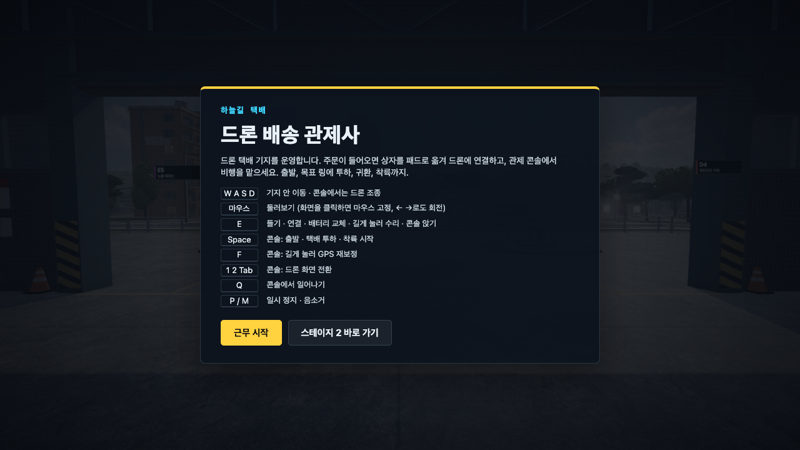

## Run it locally

```bash
npm install
npm run dev            # http://localhost:5173  (PORT=xxxx to change)
```

Production build:

```bash
npm run build
npm run preview        # http://localhost:4173  (PREVIEW_PORT=xxxx or PORT=xxxx to change)
```

Both servers bind to `localhost` only. `npm run verify` runs the TypeScript check and the production build.

Desktop browser with keyboard and mouse required. Below 900 px wide (or on a touch-only device) the game shows a "PC 전용 게임" (desktop required) notice instead.

## Controls

| Key | In the depot (first person) | At the control console |
| --- | --- | --- |
| `W A S D` | Walk | Steer the selected drone while it hovers (drop / landing) |
| Mouse, `← →` | Look around (click the view to capture the mouse) | — |
| `E` | Pick up a crate or battery · attach a crate · swap a battery · sit at the console. **Hold** to repair a rotor | — |
| `Space` | — | Launch · drop package · begin landing |
| `F` (hold) | — | Recalibrate a drone's GPS after a GPS fault |
| `1` `2` `Tab` | — | Switch drone feed |
| `Q` | — | Stand up and leave the console |
| `P` / `Esc` | Pause | Pause |
| `M` | Mute | Mute |

## How a delivery works

1. **Order** — a new order appears on the 주문 (orders) panel (destination code, name, time left) and its crate lands on the cargo shelf, colour-coded and labelled with the destination code.
2. **Load** — walk to the shelf, `E` to pick up the crate, carry it out to the pad, `E` to attach it under the drone.
3. **Launch** — walk to the 관제 (control) console, `E` to sit, `Space` to launch. The console shows the drone's camera feed, a minimap and every drone's status card.
4. **Drop** — the autopilot cruises at 30 m, then descends to 12 m over the destination and holds. The wind pushes it around. A magenta ring shows where the package would land right now; steer it onto the target with `WASD` and press `Space`. Within 2 m is 완벽 (perfect), 5 m 우수 (good), 9 m 양호 (OK), beyond that it is 빗나감 (miss) and the package is lost.
5. **Land** — the drone flies home and holds over its pad. Steer it back over the H if the wind moved it and press `Space`. Starting the descent more than 2.6 m off-centre is a hard landing and damages a rotor.

A normal round trip (takeoff, cruise, drop, return, landing) takes **30–40 s of game time**; see [Measured round trips](#playtest).

## Events

| Event | What happens | How to fix it |
| --- | --- | --- |
| **Battery low** (배터리 부족 / 배터리 교체) | Batteries drain in flight (faster than you think when a drone is left hovering). Below 35 % the console refuses to launch; at 0 % the drone falls out of the sky (-60, cargo lost, 12 s recovery, comes back broken and empty). | Take a charged battery from the 충전 (charging) rack (`E`), carry it to the pad, `E` to swap. |
| **GPS fault** (GPS 장애) | Mid-flight the autopilot loses its position fix and pauses; the drone drifts with the wind. | At the console, select the drone and **hold `F`** for 2 s. |
| **Rotor fault** (로터 고장 / 로터 수리) | After a hard landing, a crash or (randomly) a rough flight the drone reports rotor vibration and cannot launch. | Walk to the pad and **hold `E`** for 2 s. |

## Stages

| Stage | Drones | Target | Shift time | What changes |
| --- | --- | --- | --- | --- |
| 1 · 주간 근무 (Day Shift) | 1 | 450 pts | 7:00 | Light wind, orders every ~22 s, 2:00 per order. The second flight always has a GPS fault so you learn the fix. |
| 2 · 러시아워 (Rush Hour) | 2 (fly at the same time) | 1000 pts | 8:00 | Pad 2 opens. Stronger wind, orders every ~13 s, 1:45 per order, more faults. |

Reach the target before the shift timer runs out to clear the stage; run out of time and the stage fails (retry from the result screen). Each stage starts with a briefing and ends with a result screen (score, deliveries, drop grades, faults fixed, battery swaps, best combo, average round trip, rank).

### Scoring

- 100 per delivery, +60 완벽, +25 우수, +30 정시 (on time) (dropped within the first 75 % of the order window).
- Combo: each consecutive delivery adds x0.25, up to x2. A miss, an expired order or a crash resets it.
- Missed drop -20, expired order -40, crash -60.

## Gameplay additions from playtesting

The first playable build was only the brief's loop: load, launch, drop, land. After playing it, these were added, each for the reason given:

- **Wind, a drop predictor and graded drops.** At first a drop happened the moment you pressed Space, so it took no skill. Now the wind drifts both the hovering drone and the falling package. A magenta ring shows where the package would land, and the drop scores PERFECT, GOOD, OK or MISS. That turns the drop into a short aiming task.
- **Landing you steer, with a hard-landing check.** Returning used to need no input. Now you line the drone up over the H. Starting the descent off-centre damages a rotor, which gives the rotor fault a cause the player can see.
- **Order deadlines and an on-time (정시) bonus.** Without a clock, letting orders pile up cost nothing. Expiring orders (-40) and the bonus make you choose which order to take next.
- **Combo multiplier (up to x2).** This rewards a clean run of deliveries. In Stage 2 it pushes you to keep both drones busy rather than safe.
- **Hover battery drain and crashes.** A drone left waiting over a target still burns battery. If it runs out, it falls (-60, 12 s recovery, comes back with a rotor fault). This makes leaving a drone unattended in Stage 2 a real risk.
- **Objective tracker, 3D marker and attention ping.** In Stage 2, playtests kept losing a drone that was waiting for input while the player was walking around the depot. A "다음" (next) line, a floating marker in the depot and a double ping every 3.5 s while any drone needs you fix that.
- **Scripted GPS fault on the second flight of Stage 1.** Random faults sometimes never appeared in Stage 1. Now every player meets the GPS fix once before Stage 2 makes faults common.
- **Result rank (S/A/B), stats, retry and a lose condition.** Clearing a stage needed a payoff, and failing needed a way back in. The shift timer ends the stage on failure, and the result screen offers retry, next stage or title.

## Considered and deferred

- **Fragile or heavy cargo** that changes drone speed or drop tolerance. This adds a third variable to an already busy Stage 2; it would fit a Stage 3.
- **Weather and night shifts** (rain lowering visibility in the feed, gusts). The wind already covers the main mechanic; these would be mostly visual work.
- **Upgrades between stages** (bigger battery, faster charge). Two stages are too short for an economy to matter.
- **Diegetic order board** (a wall screen in the depot instead of a HUD panel). Nice for immersion, but the HUD panel is easier to read while walking.
- **Touch and gamepad support.** Out of scope; the game is desktop-only and shows a notice on small screens.
- **Manual flight in cruise.** Holding one direction through about 10 s of cruise would add little. With the autopilot cruising, cruise time is free for depot work, and the steering happens in the two hover moments.

## Playtest

`npm run playtest` builds the game, serves it with `vite preview` on localhost, and opens it in Google Chrome through playwright-core. A bot then plays with real keyboard input:

- It walks to the shelf, picks up a crate, attaches it on the pad and launches from the console.
- It steers drops and landings using the `?debug=1` hook to read the aim error.
- It forces a battery-low event (Stage 1) and a rotor fault (Stage 2), and handles the GPS faults that occur.
- It plays both stages to the end, runs the shift clock out once to check the lose condition, and checks the phone-width notice.

Each stage's first trip runs at real speed. After that the bot runs game time at x3 (`PLAYTEST_SPEED`), so these times are game seconds.

Last runs in headless Chrome 1280x720 (2026-11-23), all values in game seconds:

| Run | Stage 1 trips | Stage 2 trips | Stage 1 | Stage 2 |
| --- | --- | --- | --- | --- |
| A | 32.9, 36.3 | 35.6, 31.0 | clear 713/450 in 96.8 s | clear 1046/1000 in 69.3 s |
| B | 33.2, 37.1 | 35.9, 37.0, 32.3 | clear 713/450 in 97.9 s | clear 1046/1000 in 72.7 s |
| C (Stage 2 only) | — | 35.6, 33.5 | — | clear 1046/1000 in 71.5 s |
| D | 32.0, 38.1 | 33.4, 31.0, 34.2 | clear 713/450 in 97.8 s | clear 1046/1000 in 82.2 s |
| E (realism pass) | 33.1, 45.6 | 31.7, 32.4, 34.1 | clear 713/450 in 110.9 s | clear 1046/1000 in 77.4 s |
| F (realism pass) | 32.1, 37.2 | 34.7, 32.2, 33.5 | clear 713/450 in 100.8 s | clear 1046/1000 in 79.7 s |
| G (realism pass) | 33.0, 36.4 | 33.6, 34.5, 35.0 | clear 713/450 in 99.4 s | clear 1046/1000 in 75.0 s |

Runs A–D (before the realism pass) measured 16 round trips from **31.0 to 38.1 s**, with a mean of 34.3 s, inside the 30–40 s target. A clean trip with no events takes 31–34 s. Trips with a GPS fault, or a longer steer onto the target, take 35–38 s. Runs E–G use the realism renderer; the game rules are unchanged. The one outlier, 45.6 s in run E, had a GPS fault and a random rotor fault on the same flight; every other trip ran 31.7–37.2 s.

Frame rate in the playtest's headless Chrome on an Apple M5 (Metal), 1280x720, after the realism pass: about **36 FPS** in the depot and **41 FPS** at the flight console (`fpsBase` / `fpsFlight` in the playtest output). This is information only; graphics settings are not tuned for lower-end GPUs yet.

Events, all resolved by the bot:

- Battery set to 20 % on the pad: battery swapped, 20 % -> 100 %.
- GPS fault (scripted on Stage 1 flight 2, random in Stage 2): fixed by holding F at the console, and the autopilot resumes.
- Rotor fault on Drone 2 in Stage 2 (forced) and a random rotor fault in Stage 1: repaired by holding E at the pad.

Other checks:

- Running the clock out ends the stage with `phase=fail` and shows the failed screen.
- At 390 px width the "PC 전용 게임" notice shows.
- No console errors or page errors.

Screenshots (`docs/screenshots/`):

| | |
| --- | --- |
| 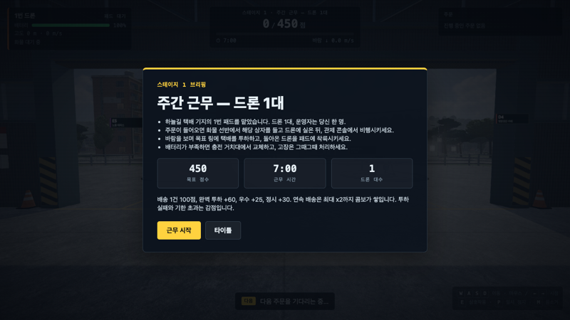 | 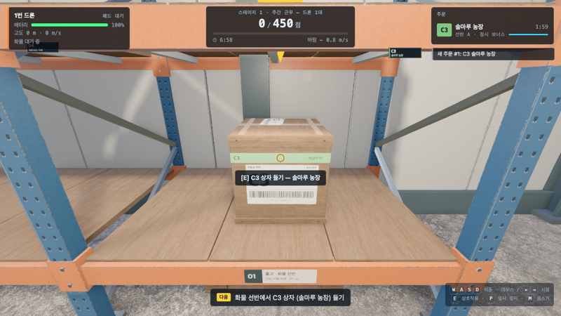 |
| 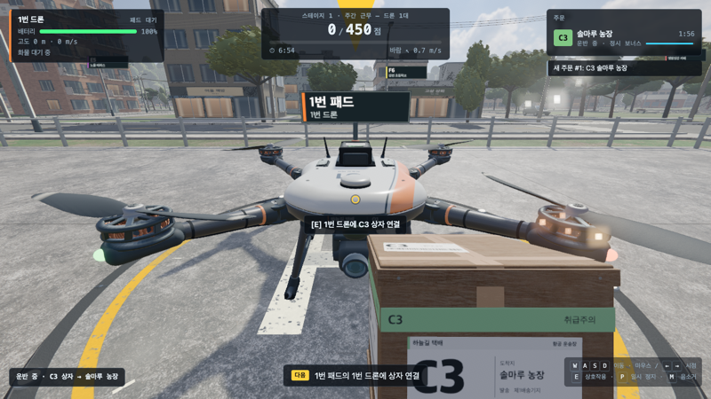 | 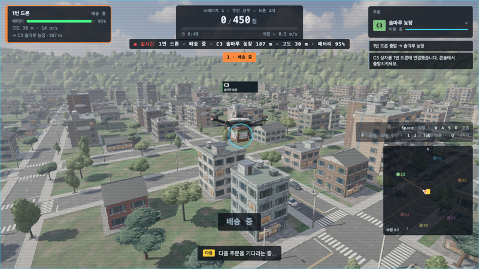 |
|  | 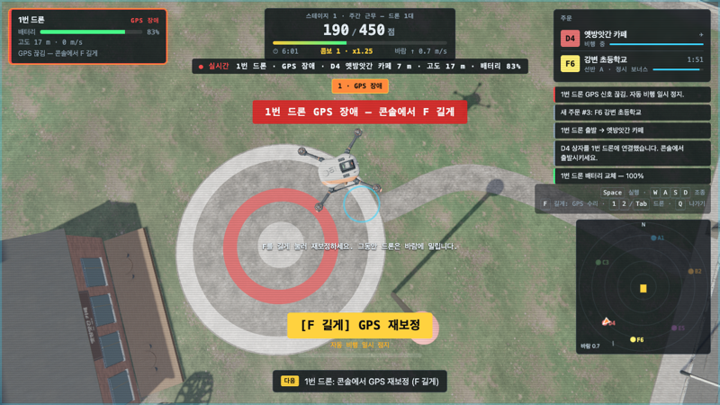 |
| 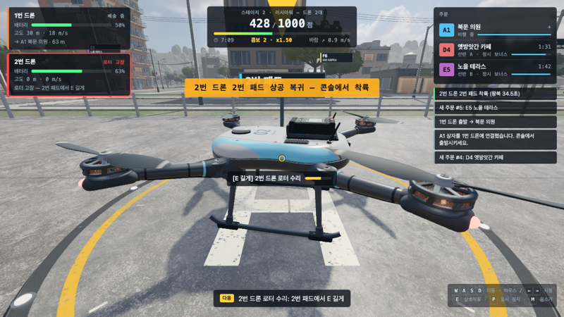 | 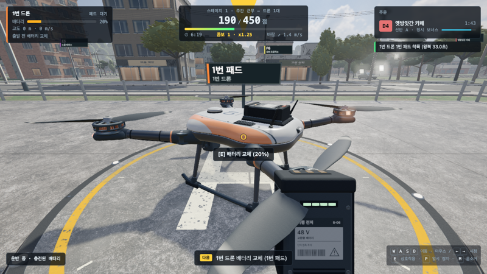 |
| 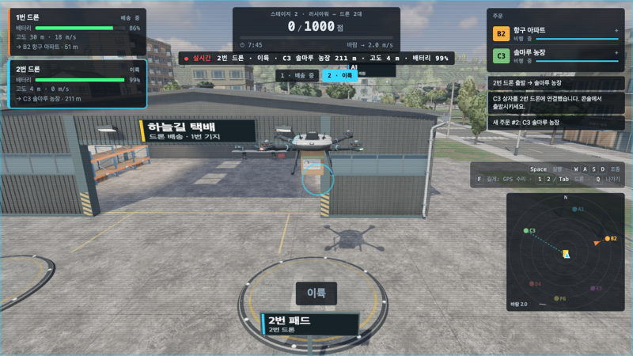 | 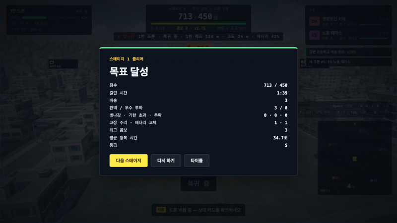 |
| 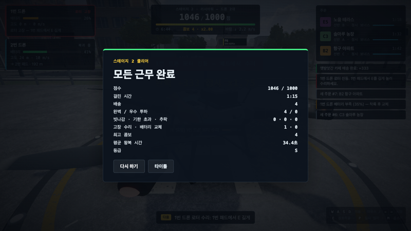 | 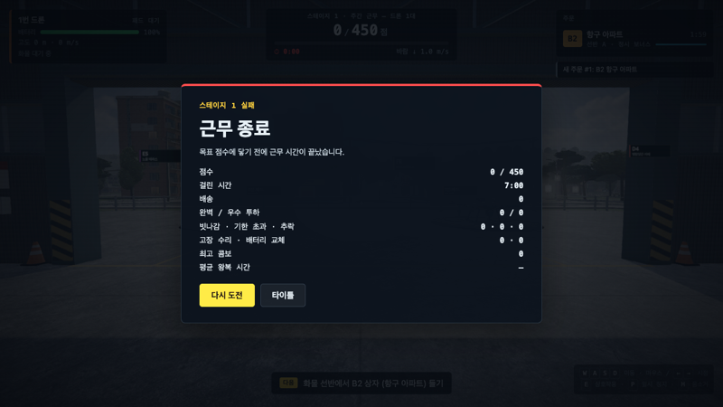 |
| 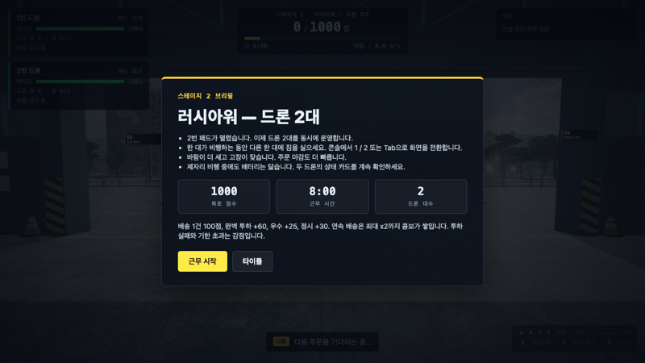 | 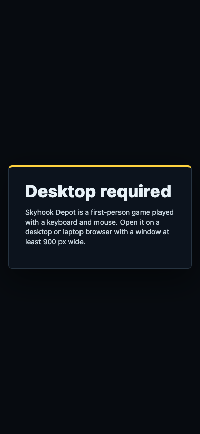 |

Options: `CHROME_PATH=/path/to/chrome`, `PLAYTEST_SPEED=1` (all real time), `PLAYTEST_ONLY=1|2`, `HEADED=1`, `PLAYTEST_GL=swiftshader` (software rendering instead of the default Metal GPU backend).

## Graphics

The renderer aims at photorealism:

- **Lighting.** A CC0 HDRI sky lights the scene through PMREM image-based lighting. The sun is aligned with the HDRI. There are three stabilized soft-shadow cascades, plus height fog and aerial scattering tinted from the HDRI horizon.
- **Post-processing.** GTAO ambient occlusion, restrained bloom, AgX exposure and grading, a vignette and subtle lens effects, and SMAA. Output is sRGB. Gameplay markers (pads, drop rings, destination labels) render after grading, so they stay readable.
- **Materials.** Scanned CC0 PBR surfaces (diffuse, normal, packed AO/roughness/metalness) with anti-tiling cover the ground, roads, depot floor, plywood and metal. They are backed by a preset library for painted steel, rubber, glass, carbon, plastic, aluminium, LEDs and cardboard.
- **Models.** The drone is detailed: moulded shell, carbon arms, folding hinges, motors, twisted props with blur discs, Korean livery, gimbal camera, winch and nav lights. In the depot, the racking, kraft parcels with Korean barcode labels, charging docks, the three-monitor console and the clad hangar are modelled. Outside, the Korean town has varied façades, roofs, trees, cars and crosswalks, and each destination has its own landmark.

Code lives in `src/graphics/` (`pipeline.ts` and `post/`, `materials.ts` and `materials/`, `drone.ts` and `drone/`, `depot.ts`, `crate.ts`, `terrain.ts`, `city.ts`, `destinations.ts`).

Before and after (`docs/screenshots/realism/`):

| Before | After |
| --- | --- |
| 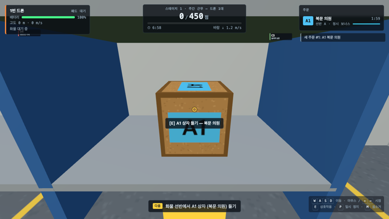 | 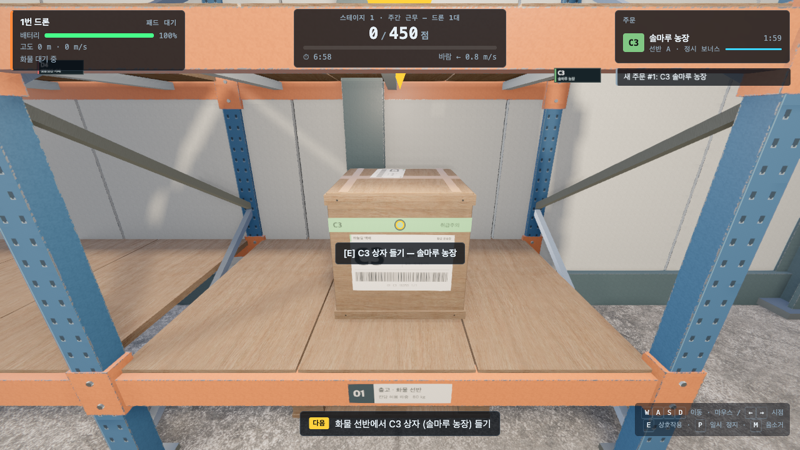 |
| 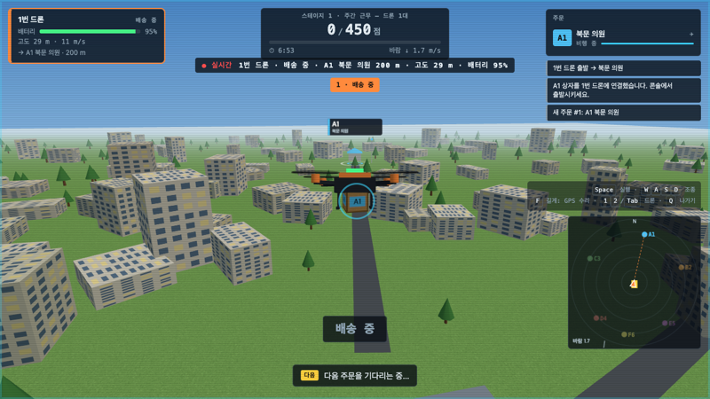 | 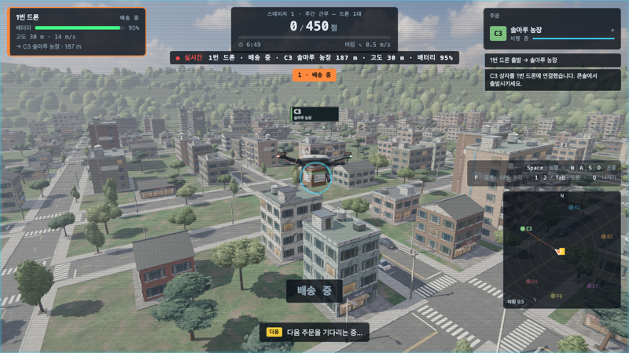 |
| 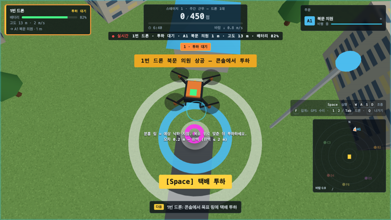 | 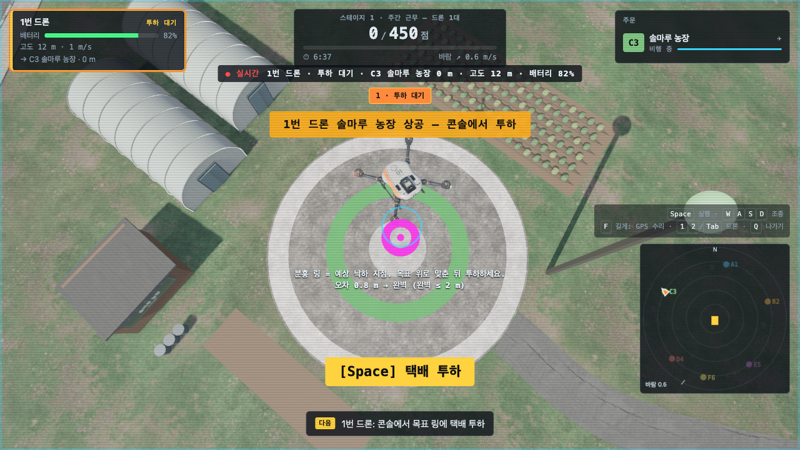 |
| 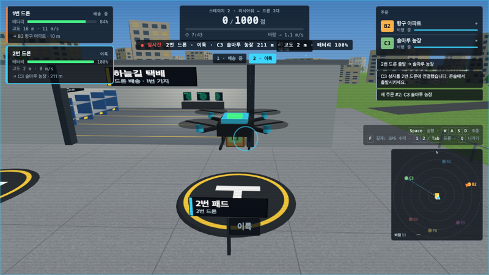 | 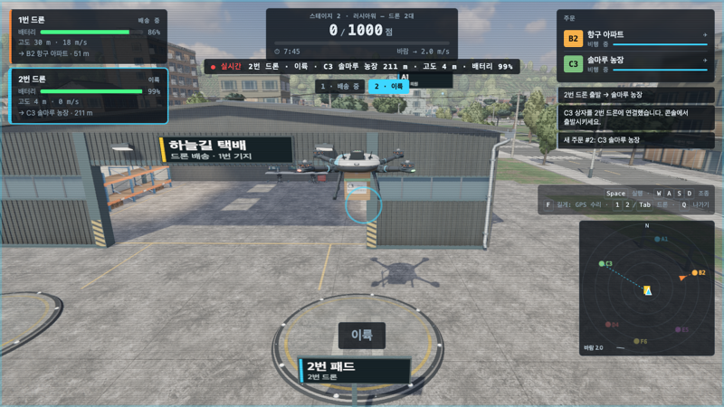 |

## Localization

All player-facing text is Korean: title, briefing and result screens, HUD, order panel, destination names, alerts, interact prompts, control hints, pause screen, event names, drop grades, the desktop-only notice, and the canvas-drawn depot signs, pad labels and destination labels. Code identifiers stay in English.

Fonts are system Korean fonts first (Apple SD Gothic Neo on macOS, Malgun Gothic on Windows), with Noto Sans KR from Google Fonts (free, SIL Open Font License) as the fallback. Canvas signs use the same stack, so Hangul renders there too.

## Development

- `src/config.ts` stages, destinations and every tuning number (flight speeds, battery drain, scoring).
- `src/sim.ts` the whole game as plain state and a `step(sim, input, dt)` function.
- `src/world.ts` Three.js scene that draws the sim state; `src/graphics/` holds the render pipeline, materials and models (see [Graphics](#graphics)). `src/hud.ts` DOM HUD, console overlay and minimap. `src/main.ts` screens, input and loop.
- `scripts/playtest.mjs` automated playtest (see above).

### Debug hook

Add `?debug=1` to the URL to expose `window.__game` (off by default):

```js
__game.snapshot()            // phase, score, drones, orders, stats
__game.setTimeScale(3)       // speed up game time
__game.trigger('battery', 0) // drone 1 battery to 20 %
__game.trigger('gps', 1)     // GPS fault on drone 2 (next time it is cruising)
__game.trigger('motor', 0)   // rotor fault on drone 1
__game.trigger('order')      // next order now
__game.goto('shelf:0' | 'rack' | 'pad:1' | 'console')
__game.showBriefing(2); __game.begin()
__game.log                   // timestamped game events (launch, drop, touchdown, faults…)
```

`&nolock=1` skips pointer lock (useful for automation).

## Assets and licences

The game bundles Poly Haven’s CC0 Kloofendal 48d Partly Cloudy Pure Sky HDRI and seven CC0 scanned materials. The browser loads all eight assets from local files. [Asset credits and source links](public/assets/ASSETS.md).

Geometry, Korean signage, cargo labels and radar graphics are generated by the game. Audio is synthesized with the Web Audio API. Fonts are system Korean fonts, with Noto Sans KR (SIL OFL 1.1) loaded from Google Fonts only as a fallback.

Libraries: [three](https://threejs.org) (MIT), [Vite](https://vitejs.dev) (MIT), TypeScript (Apache-2.0); playtest only: playwright-core (Apache-2.0).

UI layout patterns (status cards, order list, notification feed, briefing and result screens) were informed by browsing the general HUD patterns collected on gameuidatabase.com, interfaceingame.com, gameui.matme.info and gameui.net. No layout, art, name or character from any specific game was copied.
